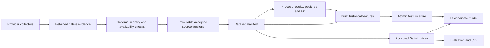

# Racing Data Flow

Architecture updated 7 November 2026. Operational counts belong to publication
receipts and the status command; this page describes the implemented flow.
The [previous audit](docs/archive/Racing_Data_Flow_before_source_contracts_2026-11-07.md)
preserves the measurements made against the 6 November store.

## The common boundary

Collectors have provider-specific parsers and raw stores. Every ordinary history
build now selects immutable accepted source versions through one dataset manifest.

Source tables retain their own grains. Results are runner appearances; pedigree
is per horse; weather is per race; RTV snapshots are per runner and capture time;
FX is a dated reference; exchange prices retain native market and selection IDs.
Their publication and consumer-selection rules are shared.

## Owners and outputs

| Stage | Owner | Output |
|---|---|---|
| Collect and retain | src/ingestion/, coordinated by pipeline.py | Native stores, raw responses, resumable queues |
| Validate and publish | src/ingestion/publication.py, src/source_contracts.py | Typed observations, identity links, timing and quality receipts |
| Select immutable inputs | src/source_dataset.py | Content-addressed dataset manifest under data/sources/datasets/ |
| Process | src/data_processor.py | Results, pedigree and FX from that selected manifest |
| Build and append | src/store_refresh.py, src/store_build.py | Features and carried state using the same selected versions |
| Commit | src/feature_store.py | Five store files committed together; metadata includes the manifest |
| Fit and evaluate | src/training.py, src/source_prices.py, src/clv.py | Candidate run with exact feature-source and Betfair versions |
| Predict | src/live_prediction.py | Selected inputs for the whole card calculation; decision-time snapshot checks |

Every processing, feature and price read goes through a selected dataset. No
route reads a collector's own cache, and there is no name-joined fallback. A
frame from `process_data()` carries its dataset ID and is replayed against it.
A research frame without one uses the last committed dataset and never starts a
publication; with no committed dataset the call stops and says to publish
sources. A store built before source publication records no dataset and is
rebuilt; live prediction refuses such a store. Tests select a small explicit
dataset (`tests/conftest.py`). The in-memory FeatureStore.build remains a
reference implementation for tests; the production full-build route is batched.

## Each source

| Source | Accepted table | Identity and timing |
|---|---|---|
| Sporting Life | sl/results | Canonical race ID and horse ID; declared results types |
| Pedigree | pedigree/horses | Horse ID; captured in the same database transaction as results |
| Weather | weather/races | Race ID; raw missingness reported before processing; research role |
| ATR | atr/sectionals | Persisted native-to-canonical runner links; 48-hour historical availability assumption |
| Racing TV | rtv/runs, cards, pre, text, scores | Canonical links for materialised history; persisted links for captured snapshots; existing run-availability and pre-decision cutoffs |
| FX | fx/units, rates | Frozen reference files; EUR conversion uses a rate strictly before race date |
| Betfair | betfair/bsp, bsp_early, timing, place_bsp | Namespaced market/selection IDs and persisted canonical links; evaluation/teacher prices, never live predictors |
| BHA stewards | bha/reports, documents, race_notes | BHA year/fixture keys and native race numbers; full JSON/PDF evidence, recorded observation times and revisions; history features use an explicit 48-hour assumption |

BHA is included in normal source refreshes. Full reports add going, rails,
non-runner reasons and suspension context beyond the summary feed. Historical
catch-up uses the same durable collector. Normal feature building derives 161
horse-history candidates, available to feature selection without changing the
current production allowlist. The configured 48-hour availability rule is an
assumption; raw capture times remain unchanged. See
[BHA collection and coverage](docs/operations/BHA_REGULAR_INGESTION_2026-11-07.md)
and [feature definitions](docs/research/BHA_FEATURE_CANDIDATES_2026-11-07.md).

Weather is also present in the results snapshot because the legacy canonical
schema stores those measurements on runner rows. Its separate publication makes
race-level coverage inspectable; it is not joined twice during processing.

## Publication contract

Each published source version records its contract version, grain, required
columns and declared keys, actual Arrow schema, row counts, file hashes,
provenance and quality reports. Identity and timing sidecars share the same
immutable version as their observations. A source pointer moves only after all
files and receipts are complete. Replay verifies content hashes.

A failed optional adoption keeps its last accepted observations and writes a separate
publication-status receipt. A provider with no accepted optional version remains
absent from the manifest. Selected absent inputs cannot fall back to a cache
that appears halfway through a build. Required canonical input failures stop
selection.

Retained observations are re-linked against the current canonical fields. A
newly restored namesake can therefore invalidate an old name-only link without
discarding the raw observation or assigning it to the wrong runner.

Collectors may continue while a build runs. The parent, helper processes and
input-writing thread all use the versions chosen at the start. Atomic output
publication and immutable input selection protect different boundaries.

Publication advances data/sources/datasets/latest.json only after the complete
dataset is ready. Builds select that commit, so independently advancing provider
pointers cannot expose a half-published refresh. Historical adoption is serialised
without locking readers of the previous commit. An installation without accepted
versions bootstraps once; later native changes enter through source publication.
Pandas frames carry only the manifest ID; stores and runs retain the full receipt.

## Identity rules

Provider IDs never substitute for Sporting Life IDs. Publication stores the
native IDs, canonical IDs, matching method and a status for every source row.
A unique date/track/off-time/name match may establish a crosswalk. A checked,
existing canonical link can resolve namesakes. Conflicting known IDs never fall
back to a name.

Ambiguous and unmatched observations remain available for review but supply no
model value. Duplicate declared native identities fail validation of the
affected candidate. Downstream ATR, RTV snapshot, training-price and CLV joins
use saved canonical links only. A bet or target that has only names is first
resolved to canonical IDs by the same identity rule, so CLV cannot multiply bets
through ambiguous names. The collector's own name matcher (`src.betfair`) remains
for collection and for research scripts that have not yet moved to IDs.

## ATR promotion

Publication reads one transactionally consistent snapshot of the running rebuild
queue. A race is eligible only when it has a completed data state, every current
performance tab has a terminal receipt, its collection version is current, its
native identities are unique, its canonical identities still match, and the
publication delay has elapsed.

Promotion replaces observations only for proven runner identities. It preserves
legacy runners absent from the new valid subset. Incomplete or invalid races are
reported individually. The worker checkpoint, retained raw payloads and original
legacy cache are not overwritten. Normal refresh, local publication and build
selection use this same promotion function.

The active collector's pinned modules do not import this new publication layer,
so adding or running publication does not change its parser generation.

## Availability and missingness

Observation receipts distinguish event time, recorded observation time,
available time, the basis of that available time, identity rejection reasons
and missing-field counts. Missing observation timestamps remain missing.

ATR's event-plus-48-hours policy is an assumption for reconstructed history,
not evidence of an archived historical capture. Its rolling features use only
observations available by the target decision. Untracked starts still occupy
window slots. Missing comments remain missing. FSP support and observation age are
available as atr_observation_count_5 and atr_days_since_observation.

RTV pre-race features still require a captured observation before the forecast
cutoff. Current cards participate in snapshot identity resolution. A retrospective
card is not claimed to be a recorded pre-race capture.

The unused ATR speed composite now uses field-relative scaling; the stride/course
interaction uses fixed course circumference in miles. Both are independent of
arbitrary batch size. This changes feature code and
requires a rebuilt store and newly fitted candidate before compatible serving.

## Health and refresh policy

Reports separate the latest collection attempt from accepted-data readiness.
For runner observations they report collected rows, matched rows, unique linked
runners, currently usable rows, eligible-population coverage, all-runner coverage,
latest usable event, age and rejection reasons. Snapshot counts are not treated
as distinct runners. Horse/race reference tables do not use runner denominators.

Source policies explicitly distinguish required canonical/FX checks, optional
enrichments, research weather and delayed exchange evaluation prices. Expected
publication waits are visible limitations. They do not by themselves invalidate
otherwise usable training history. Existing database, feature-code, history and
selected-model compatibility checks remain in force.

Late changes still trigger conservative full rebuilds. Normal training refreshes
record rebuild reasons and previous/current manifest IDs in data/sources/builds.json.
No dependency-based partial repair is enabled without parity evidence.

## Commands and replay

Publish accepted local sources and promote ready ATR observations, without HTTP:

    .venv/Scripts/python.exe -m src.ingestion --publish-sources

Inspect accepted versions and quality separately from collection progress:

    .venv/Scripts/python.exe -m src.ingestion --source-status
    .venv/Scripts/python.exe scripts/project_status.py --json --quick

Ordinary collection remains:

    .venv/Scripts/python.exe -m src.ingestion --sync 14

Rebuild a separate candidate store from an exact recorded dataset:

    .venv/Scripts/python.exe -m scripts.build_feature_store_batched --dataset-manifest DATASET_ID --store-root data/processed/candidate_store

Dataset manifests and source generations are retained because saved runs refer
to them. Publishing data does not fit or promote a model. Check compatibility
and review a fitted candidate before changing the selected run.

## Evidence and scope

The [implementation report](docs/operations/SOURCE_PUBLICATION_2026-11-07.md)
records qualification and operational limits. Prefix-based counts such as
“108 database inputs” are removed: source versions and publication receipts
provide concrete dataset lineage, while exact field-by-field ancestry is not
claimed.

Unused research columns and weather are retained. Their storage/build cost and
predictive value should be measured before removing them. Broader framework
renaming and partial-history rebuilds are outside this change.
