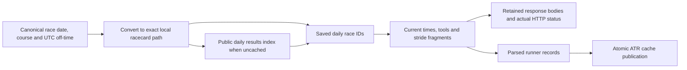

# BSP provenance and ATR repair — 5 November 2026

**Betfair update, 6 November:** the public downloader and manual extraction
commands described here are retired. See the [current consolidation and catch-up](BETFAIR_CONSOLIDATION_2026-11-06.md).

**Later implementation:** the omissions and unit-mixing issue described below
are fixed. The [qualified full rebuild](ATR_REBUILD_2026-11-05.md) is running and
was resumed after shutdown. This document retains the earlier diagnosis.

Position checked at **09:18 UTC**. The ATR endpoint repair recovered **30 races /
248 runner records** through the normal source coordinator. Fetching sectionals
works once the native race IDs are known. **Unattended recovery remains partial**:
ATR challenged the next uncached day's results index. Progress is saved and the
normal retry limit remains in force.

## Where BSP comes from

The accepted teaching cache is `data/processed/betfair_bsp.parquet`. It combines:

1. **Betfair Historical BASIC archives**, retained under `data/betfair/` and
   imported by `scripts/extract_betfair_bsp.py`. These provide historical BSP
   and the available timestamped last-trade observations, including the
   one-minute and five-minute pre-off fields.
2. **Betfair's public daily CSV files**, fetched by
   `scripts/fetch_betfair_sp_public.py`. Ordinary maintenance now calls this
   through `src.source_auxiliary.refresh_bsp` and the shared coordinator.
   The normal refresh downloads GB and Irish **WIN** markets.

The daily URL is:

```text
https://promo.betfair.com/betfairsp/prices/dwbfprices{uk|ire}win{DDMMYYYY}.csv
```

The file is dated the **day after** its races. Thus `dwbfpricesukwin05112026.csv`
contains the GB races run on 4 November. Raw files are retained under
`data/betfair_sp_public/win/{uk|ire}/`, named by race date locally. The parser
converts local off-times to UTC and normalises course/runner keys before the
merge. Existing prices and archive timing fields take precedence; public
additions fill absent prices without replacing accepted observations.

Betfair confirms daily CSV publication for GB/Irish win and place BSP, plus
aggregated prices, with records extending back to May 2008 on its
[official history page](https://promo.betfair.com/betfairsp/SP_history.html).
The public download does not require a Betfair session. The current merged
cache contains **819,097 rows through 4 November 2026**; all **496 runners in
47 finished fields** on that day have BSP.

For BSP alone, the daily route removes the need for repeated manual archive
imports. Its volume-weighted averages and ranges cannot reconstruct actual
prices at T−60 or T−300; obtaining those observations for an uncovered period
still requires suitable timestamped historical data.

## What was wrong with ATR

The collector called the old `/ajax/sectionals/{raceid}/...` route. The public
website currently advertises `/ajax/sectionals-razor/{raceid}/{times|tools|stride}`.
The existing split/pace/stride parsers still understand the current fragments.

The racecard lookup was a separate obstacle: ATR returned a small **HTTP 200
Client Challenge** page. The client correctly treated it as retryable, but
reported it internally as 429, obscuring the real response. Browser headers
did not guarantee access. An ordinary browser displayed the race and all its
sectional tabs without login.

The public daily results index pairs each racecard path with its native race
ID in that race's result article. A successful ordinary HTTP request retrieved
the 2 November index. Another fresh session was challenged. The repair therefore
retains successful ID mappings for reuse across sessions.

## Installed collection flow



The implementation in `src/attheraces_scraper.py` now:

- Scopes ID discovery to each result article, rejecting conflicting IDs.
  It does not infer IDs from numeric sequences. The exact-day filter also
  excludes overseas races indexed after midnight on the next calendar day.
- Retains successful mappings under `data/atr_cache/results_index/`. Within
  a session it reads an uncached day once; saved mappings avoid another index
  request in later sessions. The first index is retained with its response
  hash and retrieval time in the audit evidence.
- Calls the three current Razor endpoints. This normally costs three requests
  per race, plus one index request per day, instead of opening every racecard.
- Handles current horse URLs containing a country segment, preserving native
  ATR horse IDs. ATR IDs remain distinct from Sporting Life IDs.
- Uses exactly the UTC-to-local time conversion. The former unadjusted summer
  fallback could identify another real race an hour earlier; it is removed.
- Retains decoded HTML and actual HTTP statuses in `data/atr_cache/raw.sqlite`.
  Challenges are logged as HTTP 200 challenges and remain retryable blocks.
- Stops on a blocked tab before accepting a partially collected race. A
  later failed tab cannot leave an incomplete race permanently skipped.

The coordinator and direct backfill both defer races younger than 48 hours.
ATR's [publication guide](https://www.attheraces.com/sectionalsinfo) describes
approximately this delay. Deferral is a scheduling allowance, not proof that
data will exist after exactly 48 hours. Young races remain pending rather than
entering the permanent absence list. Queue progress now subtracts resolved
races rather than every attempted request.

## Live verification and remaining limitation

| Check | Result |
|---|---|
| Single-race route | 10 Wolverhampton runners; all three tabs HTTP 200; names exactly match canonical results |
| First ordinary coordinator batch | 25 races / 198 records in 153.012 seconds |
| Next coordinator batch | Five further races / 50 records, then next-day index challenged; 77.275 seconds including retry |
| Total accepted recovery | **30 races / 248 records**, all on 2 November |
| Recovered content | All 248 have split times, sectional speeds and stride arrays |
| Runner joins | All 248 match canonical records one-to-one |
| Existing ATR data | All **232,149** earlier rows, values and dtypes unchanged |
| Accepted ATR total | **232,397 rows** |
| Absence list | Unchanged; no challenge or partial race marked absent |
| Remaining current recovery window | **3,936 races**, including **60** waiting for the publication allowance |
| Next retry | **10:14:09 UTC on 5 November** |
| Source/parser/feature regression checks | **130 passed** in the pinned Python 3.14 project environment |
| Lint and changed-file whitespace | Pass |

The original cooldown came from the legacy racecard route. After the three
corrected endpoints were independently verified, one bounded normal test reset
that old local cooldown, retaining its previous value and the reason in
`legacy_cursor_reset.json`. The next new-day challenge reinstated normal
backoff. There was no proxy rotation, credential transfer or CAPTCHA solving.

**The unresolved access problem is uncached-day ID discovery.** The next
`/results/01-November-2026` request was challenged twice, separated by the normal
30-second retry. The collector then stopped. Saved IDs make repeated access
to a known day reliable in this measured run; they do not establish dependable
unattended access to every new day. Public-browser ID collection can support
recovery, but a fully automatic browser-to-collector path is not installed.

There are also **379 older no-data decisions**, including 212 at Chelmsford
City, predating the current recovery window that starts on 21 June. They were
not revalidated by this repair; their validity cannot be inferred from the
working Razor route. Their keys are retained in `legacy_no_data_review.json`
for a separately scoped historical review.

The results CSV, BSP cache and model pointer were unchanged by the initial
publication check. This pass performs no feature rebuild, model fit or
promotion. The source inputs have changed, and the collector shares a
fingerprinted module with ATR feature joins: current FE is
`aed36c32a39b83d9`, while the installed store remains `1355eccb0838ad9b`.
Batch source recovery before the next full-history build.

All responses, before-copies, test output, recovery reports and final
preservation checks are under `data/audit/atr_diagnosis_20261105/`.
`final_verification.json` is the final cache/identity check;
`recovery.json` and `recovery_next.json` are the actual coordinator results.

## 09:33 follow-up: running status, duration and content completeness

No ATR recovery process was left running after the 09:14 batch. The saved
10:14 cooldown is an earliest permitted retry, not an automatic restart.
Process inspection at 09:29 found only unrelated feature research jobs.

The successful 25-race batch averaged 6.12 seconds per race. Extrapolation
gives **6.59 hours of uninterrupted collection** for the 3,876 currently mature
pending races, or 6.69 hours for all 3,936. These are processing estimates,
not completion promises: uncached-day challenges and publication delays make
the actual elapsed time uncertain.

An offline comparison against the retained HTML confirmed useful omissions
from the structured cache:

- **Per-section stride frequency:** the source has a second stride chart;
  the parser keeps the length chart and scalar peak frequency only.
- **Race-level early pace and finishing-speed percentage:** the race analysis
  header is not extracted. For the checked race it says Even and 98.74%.
- **Per-section Front markers:** the runner's leader markers are not retained.

It also found an actual parsing error in **135 cached runner records**: modern
tools tabs provide top speed, final instantaneous speed and 0–30 mph
acceleration time alongside the three sectional speeds. The parser stores all
six numbers in the speed array, with their labels, but downstream derivation
assumes that array contains only consecutive segment speeds. In the checked
example, 4.70 **seconds** occupies the closing-speed position; the plausibility
filter subsequently turns that invalid speed into missing data. The intended
closing sectional speed is 37.11 mph. This needs correction before a large
backfill and feature rebuild. The earlier endpoint regression fixtures did
not cover the extra modern tool columns.

Raw HTML is retained for all 30 newly recovered races, so these omissions and
the parsing error can be corrected offline for those races. This does not
establish raw-response availability for the older 232,149 rows. Evidence:
`data/audit/atr_diagnosis_20261105/content_audit.json`. This follow-up changed
no collector, cache, feature or model code and made no further HTTP requests.
