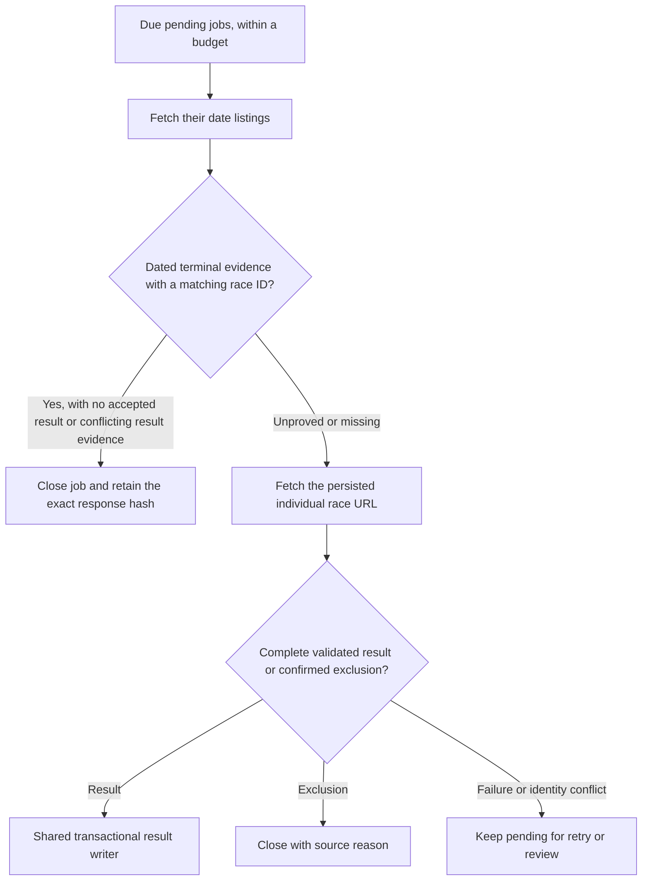

# Stage 1: historical queue recovery and identity impact

**5 November follow-up:** the coordinated identity migration is installed and
the final historical case is resolved. Both Sierra Nevada IDs survive storage
and rating joins. See the [repair and preservation report](STAGE1_IDENTITY_2026-11-05.md).
Counts below describe the earlier recovery snapshot.

This continues the [source recovery](STAGE1_RECOVERY_2026-11-04.md).
The historical Sporting Life queue fell from **3,457 jobs to one**, without
changing any accepted runner record. The remaining job is the previously
identified Sierra Nevada identity collision in race 688054.

## Recovery results

| Source-confirmed outcome | Jobs closed |
|---|---:|
| Abandoned, from dated listings | 3,189 |
| Old dormant races, from dated listings | 243 |
| Void races, from dated listings | 19 |
| Arabian exclusions, from individual pages | 5 |
| **Total** | **3,456** |

This includes all **27** previously unresolved 404 jobs. Their dated listings
provided terminal race evidence even though their individual pages were
unavailable. They were not closed merely because a page returned 404.

Thirteen bounded batches took **387.188 seconds**, using 485 listing loads
and five individual result-page requests. They examined 471 distinct listing
pages; some dates straddled batch boundaries. No source request-rate limits
were increased. The previous one-page-per-job approach would have requested
each unfinished race individually; the measured counts demonstrate the
reduction without assuming an unmeasured elapsed-time comparison.

All **757,083 accepted rows** were compared with the pre-run SQLite backup,
including every stored value. They match exactly. Factual revision **1816**
and the published CSV remain unchanged. The final recovery report correctly
shows one review case, zero due fetches and zero jobs waiting to retry.

This resolves the known unfinished-job queue. It does not establish that
every historical race was originally discovered; an independent completeness
census remains a different check.

## One shared recovery route

The shared source command now supports a bounded historical queue:

```powershell
.venv\Scripts\python.exe -m src.ingestion --sync 0 --sources sl --sl-backlog-max-races 300
```

The Data page also has an **Older result recovery** section. Its button calls
the same coordinator and reports jobs closed, jobs needing review, jobs ready
to check and jobs waiting to retry.



The implementation uses persisted URLs rather than relisting six years of
otherwise accepted history. It orders due jobs fairly, avoids retrying them
again within 24 hours, and leaves explicit correction/identity review cases
aside. Its budget applies to extra historical jobs; it never truncates the
ordinary recent result collection.

A listing can close a job only when its source date and race ID agree, its
race status is terminal, and the canonical database contains no accepted
field for that race. A dormant listing must also be outside the recent
seven-day window. Listings with a winner or winning time cannot close an
ordinary result job as unrun. Provider error pages, date mismatches and
duplicate race identities cannot provide terminal evidence.

Source responses are retained in the raw SL store. Listing resolutions in
`result_terminal_evidence` point to the exact response SHA-256, with the
source URL, date, race ID and reason. Every listing closure from this run was
independently checked and bound to one of 471 retained payloads. Future live
and offline listing parses carry that fingerprint directly.

If the provider refuses historical listing access after the existing HTTP
retries, the historical batch stops rather than fanning out into individual
page requests. Failures remain queued. Pure historical recovery writes
`data/source_refresh/backlog_status.json`; it preserves the ordinary source
coverage report and does not pretend to refresh RTV, BSP or FX.

## The identity change needs a coordinated implementation

The deeper trace narrows the earlier concern: most horse-history features
already prefer `horse_id`, and Elo/Glicko use ID-based entity keys. The 105
names with multiple source IDs are therefore review candidates, rather than
proof of 105 mixed numerical form histories.

The installed-data identity census found:

- No missing source horse IDs in the 757,083 accepted rows.
- No repeated source horse ID within an accepted race.
- Two source horse IDs associated with more than one display name.

The retained source payload for race 688054 demonstrates a concrete failure:

| Isolated operation on the same source field | Runner rows |
|---|---:|
| Source payload | 15 |
| Current race/name uniqueness constraint | 14 |
| Trial source/race/horse-ID uniqueness constraint | 15 |
| Existing preprocessing | 15 |
| Existing rating calculation | 15 |
| Current feature-store race/name rating join | **17** |

The trial called the actual processing and rating code in an isolated store.
The two different Sierra Nevada IDs survive processing, but the rating join
matches both same-name rows to both ratings. Changing only the database
constraint would expose that multiplication to normal history builds.

The coordinated change should cover:

1. `database.py`: race/source-horse identity for uniqueness and field
   replacement; preserve display names separately. Context/text observations
   and repair writers need the same identity contract.
2. `feature_store.py`: keep horse IDs in rating outputs and use them in the
   append and live-card joins, with explicit one-to-one validation.
3. `rating_reuse.py` and other within-race consumers: use the same identity
   keys; permit a name fallback only where it is unique and IDs are absent.
4. RTV and Betfair crosswalks: retain separate source namespaces. Their numeric
   IDs are not interchangeable with SL IDs.
5. Replay the retained field, rebuild compatible feature histories and qualify
   model artifacts against that generation. Compare unaffected fields before
   replacing the installed history.

This pass keeps the ambiguous field pending and preserves its accepted rows.
It also strengthens ingestion to reject names that collapse under the shared
case/whitespace normalisation, before later processing can create duplicates.
The canonical schema and numerical feature definitions remain unchanged.

## Verification and current limits

Evidence and a pre-run database backup are under
`data/audit/stage1_backlog_20261104/`:

- `batch_*.json`: every bounded batch and its page/listing counters.
- `verification.json`: independent source checks for all 3,456 closures and
  exact comparison of all accepted rows.
- `evidence_binding.json`: 3,451 listing closures linked to retained payloads.
- `queue_summary.json`: the 27 former 404s and the remaining identity case.
- `identity_impact.json`: isolated constraint and actual rating-join results.
- `final_recovery.json`: one review case, zero due fetches and zero retry waits.
- `readiness.json`: the current read-only status check.
- `regression_tests.txt`, `final_tests.txt`, `evidence_tests.txt`: source,
  orchestration, parsing, readiness and provenance regression checks.

Final regression verification: **234 passed** in 266.54 seconds. Source/test
lint, changed application syntax and whitespace checks pass. The app's three
pre-existing semicolon-style lint findings remain outside this change.

The remaining collection gap is ATR's June–November queue. A bounded retry at
23:18 UTC still encountered the provider block: **zero races fetched**,
3,934 eligible races retained, and the existing 232,138-row cache preserved.
Its next retry time is 00:18 UTC on 5 November. `atr_retry.json` records this
attempt; it does not change the verified Sporting Life recovery. The ordinary
source report retains the earlier all-source check time while recording the
new ATR outcome and updated historical queue metadata.

The saved model still belongs to an older feature generation, so overall
serving readiness remains blocked. The canonical identity migration and its
dependent feature joins are the remaining coordinated code change.
