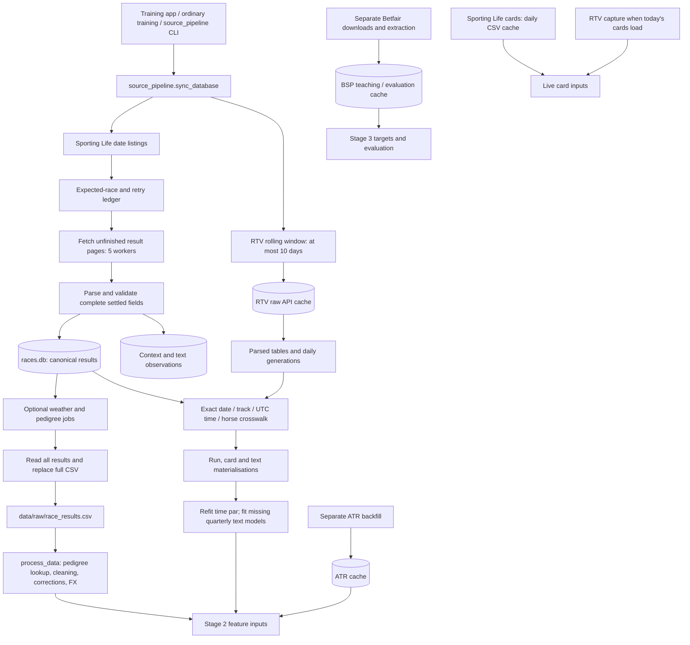

# Stage 1 audit: source collection and aggregation

Audit date: 4 November 2026. Scope: the current working tree, local source stores,
ordinary refreshes, historical backfills, and the handoff to feature engineering.
This is an audit; no collector, canonical result, feature store or model was changed.

Implementation follow-up: [the 4 November collection improvements](STAGE1_IMPLEMENTATION_2026-11-04.md)
records the subsequent authorised code changes and their verification. Findings
and counts below describe the original audit snapshot.

The [5 November identity follow-up](STAGE1_IDENTITY_2026-11-05.md) records the
subsequent canonical ID migration, restored runner, preservation checks and
compatible-history work. The [operating notes](STAGE1_IMPLEMENTATION_2026-11-04.md)
include the current consolidated process map.

## Assessment

The foundation makes sense: keep Sporting Life's sporting records separate from
RTV observations, validate complete fields before replacing them, and preserve
source-specific identities. The main problems are inconsistent operation across
sources, several incompatible write paths, and too much work on every refresh.

The highest-value changes are:

1. Include every source used by the selected inputs in the ordinary refresh contract.
   ATR currently stops in June, despite five selected inputs depending on it.
2. Distinguish discovering missing races from checking revisions to known races.
   The latter is largely absent for completed Sporting Life fields.
3. Make refresh completion explicit, including source coverage and failures.
4. Remove routine whole-history exports and repeated derived-data rebuilds.
5. Reuse the same collection, validation and publication machinery for refreshes
   and backfills, with explicit date ranges and source-specific retry rules.

This calls for consolidation around the existing local SQLite/Parquet design.
The findings do not establish a need for another database or a distributed system.

## 1. Current process



### Sporting Life

The main implementation is [database.py](../../src/database.py), especially
`_sync_database` at line 561, using [data_scraper.py](../../src/data_scraper.py).

- It considers yesterday backwards through the requested date window.
- It relists up to seven recent dates and unfinished dates inside that window.
- It records listed race URLs before requesting result pages.
- Existing fields with the expected runner count and a winner are adopted as complete.
- Unfinished fields are fetched concurrently, with a shared limiter per scraper instance.
- A fetched field must have the expected identity/date, unique runner names, valid
  finish positions, a winner, consistent labels and exactly the expected starter count.
- Field replacement and its completion record commit together. Obsolete runner rows
  are removed, and separately supplied enrichment is preserved.
- If new runner rows were inserted and enrichment is enabled, weather and pedigree run.
- Every invocation reads the entire results table and publishes the entire CSV.

The effective request-start limit is about two per second per scraper instance:
`data_scraper.REQUEST_DELAY` is 0.5 seconds. The 2.0-second value in `config.py`
is not the limiter this code uses. Five workers overlap response latency; they
do not remove the shared delay.

### Racing TV

[source_pipeline.py](../../src/source_pipeline.py) calls the resumable
[rtv_scraper.py](../../src/rtv_scraper.py) collector. It fetches listings, results,
cards, tips, tracks, RaceiQ metrics/sectionals and odds. The default client has
12 workers and a shared 10-request/second limit, with retries and backoff.

Raw payloads are compressed in `data/rtv_cache/rtv_raw.sqlite`. Unlike race-day
snapshots, ordinary responses keep the latest payload per API path rather than
an append-only sequence of revisions. Parsed historical tables are quarterly;
recent daily generations override them by date. Exact cross-source links are
required before observations can be used with canonical Sporting Life identities.

[rtv_feature_collection.py](../../src/rtv_feature_collection.py) then materialises
observations. This also fits a winning-time par and missing quarterly text
models, so the collection operation already crosses into stages 2 and 3.

### Cards and data available only before a race

Sporting Life cards are cached per date, without an automatic age limit inside
the date. Loading today's cards through `source_pipeline` also captures RTV
snapshots, throttled to one capture per 15 minutes. Actual observation times are
retained, and historical cards are not passed off as genuine pre-race captures.

This is useful groundwork, but collection is driven by app usage. Opening the app
after a race cannot recover a missed pre-race observation. The lookahead builder
also imports cards through `data_collector`, bypassing the RTV wrapper even for
its offset-zero/today pass (`live_prediction.py`, lines 447–466).

## 2. Measured local position

These are local inventory results, not fresh verification against provider websites.

| Item | Observed state |
|---|---|
| Canonical results | 755,309 runners; 80,302 races; 15 September 2020–29 October 2026 |
| Date ledger | 2,236 dates: 2,219 listing successes and 17 unresolved empty/unreadable listings |
| Race ledger | 80,347 closed jobs; 3,475 pending jobs |
| Pending jobs inside the last 90 days on audit date | 40; 3,435 are older |
| Closed jobs adopted without a result-fetch attempt recorded in this ledger | 79,121 |
| Canonical field-size discrepancies | One: race `688054`, Gowran Park, 12 June 2022; 14 stored rows versus declared 15 |
| Missing winners / missing or duplicate horse IDs within a race | Zero / zero |
| Fields with multiple winners | 121; these require dead-heat-aware handling, not automatic deletion |
| ATR cache | 232,138 rows; 10 August 2023–20 June 2026 |
| Canonical BSP cache | 816,069 rows; latest race date 27 October 2026 |
| Separate public BSP projection | 749,502 rows; latest race date 12 October 2026 |
| RTV raw day ledger | 2,236 days marked complete, through 29 October 2026 |
| RTV run / card materialisations | 753,862 / 753,715 rows, through 29 October |
| RTV text / text-score materialisations | 753,493 / 712,976 rows; scores start in 2021 |
| Horses lacking a pedigree-cache row | 442 horses, affecting 460 stored runner rows |
| Pedigree rows with all three parents empty | 58 cached horses; two of those occur in current results, affecting 31 rows |
| Missing raw weather | 21,513 runner rows; weather's feature stage has been removed |
| Missing wind-surgery flags | 152 runner rows |
| Sporting Life context / text observations | 1,389 / 283 observations; text observations cover only 2 November 2026 |

The 3,475 pending jobs are **not a count of missing races that actually ran**.
Their recorded errors are 3,444 empty/incomplete responses, 27 HTTP 404s and
four recent-at-the-time DORMANT responses. These need classification. Existing
tests explicitly document the earlier abandoned-race backlog and its code fix;
old jobs do not get that fix applied merely because the code changed.

Similarly, a materialised RTV run row can have no telemetry values. Its row
count is not a measurement of sectional coverage, particularly before RaceiQ's
configured start date. A raw day marked complete means the collector reached
its endpoint status rules, which accept 404; it does not certify complete
canonical runner matching or usable metrics.

Recent canonical BSP runner matches were 10,984/11,008 in July,
10,325/10,347 in August, 11,189/11,198 in September and 10,265/11,023 in October.
These are runner matches. The training teacher correctly requires a complete
field before choosing BSP; partial runner coverage must not be reported as
complete-field coverage. The latest two result dates extend beyond the BSP
cache's maximum date and therefore cannot receive BSP from that cache.

## 3. Findings and changes recommended

### A. Sources used by the model do not share a refresh contract — high priority

Five lines in [win_selected_056.txt](../../feature_sets/win_selected_056.txt)
select ATR-derived inputs, but ordinary `source_pipeline.sync_database` does not
collect ATR. Its cache stops on 20 June while results extend into late October.
Earlier ATR observations can still contribute historical inputs; newer runs
cannot supply new ATR measurements through this path.

BSP collection is also separate, and the ordinary refresh returns no BSP
coverage assessment. This can change the balance between BSP and SP teaching
targets over time. It is not itself leakage, but should be an explicit source state.

**Change:** define required, optional and research-only sources in one refresh
plan. Add bounded ATR catch-up and BSP update/validation where their consumers
require them. If ATR is intentionally frozen, declare that status and assess the
model impact in a separate stage-3 task. Removing selected inputs is not a
stage-1 cleanup.

### B. Rechecking a listing does not recheck completed results — high priority

`database.py`, lines 620–643, recalculates completion from stored row count and
winner presence. The job selector then fetches only `completed = 0`.
A changed placing, odds, rating, nonfinish reason or commentary can remain
unseen if the stored field still has the correct size. A changed parser also
does not automatically replay previously completed fields.

The isolated reproduction ingests a race, changes its fake source winner and
syncs again. The source result is fetched once in total; the original order remains.
The 79,121 zero-attempt adopted jobs also demonstrate why a completed ledger
cannot be interpreted as every result having been freshly source-verified.

**Change:** add a separate revision-check policy: a bounded recent recheck,
payload hashes, parser versions and an explicit older revalidation queue.
Preserve independently verified corrections when proposing changes; blindly
overwriting them from a later Sporting Life fetch could undo accepted repairs.

### C. Success does not describe completeness — high priority

Several layers suppress useful status:

- `source_pipeline._optional` returns RTV errors, but its caller discards that
  return value and returns only the canonical DataFrame.
- The Data page reports “DB synced” from the DataFrame length, including after
  individual race failures or an RTV failure.
- Training catches an overall catch-up exception and proceeds from existing data.
- RTV snapshot `state` becomes `ok` when its successful-request count is nonzero;
  it is not a required-endpoint completeness test.
- `project_status._database` checks dates/counts, not the pending-job ledger.
  RTV monitoring is added after the blocking verdict is calculated. There is no
  equivalent ATR/BSP freshness gate.

**Change:** return one structured report: requested range, observed range,
new/changed races, unresolved jobs, retries due, coverage of required fields,
per-source errors, and the generation published. Let the caller explicitly accept
a degraded optional source. Routine source status should not be inferred from
the total number of rows already held.

The existing status command was run during this audit. It reported results six
days behind and could not acquire the feature-store lock. Its apparent
missing-signature message arose from that failed access; this audit does not
establish that the stored signature is absent or that a rebuild is required.

### D. Alternate entry points retain the old data-loss paths — high priority

[data_collector.py](PRE_FEATURE_CLEANUP_2026-11-05.md) still calls `database.sync_database`
directly, skipping RTV. Its `source="scrape"` route uses the old full scraper,
whose default cap is 50 races per day and whose export contains only the
requested window. It then uses the weaker `insert_results` path, not complete
field validation/replacement. Running the scraper CLI can also publish that
window directly over `data/raw/race_results.csv`.

An unrecognised `collect_data(source=...)` value falls into sample generation.
[data_collector_sample.py](PRE_FEATURE_CLEANUP_2026-11-05.md), lines 253–255,
writes synthetic data to the same canonical CSV path. This is reachable code;
the audit does not assert that it has been invoked accidentally.

Old missing-race/draw/wind-surgery tools have their own update/checkpoint logic;
some do not republish the canonical CSV. A repair can therefore change the DB
while ordinary processing continues to read an older export.

**Change:** one supported orchestration entry point, one validated canonical
writer, and compatibility wrappers forwarding to them. Reject unknown source
names. Synthetic data needs a separate output location. Backfill tools should
submit jobs or accepted corrections to the same publisher.

### E. Catch-up and backfill interfaces do not compose reliably — high priority

`refresh_rtv_history` explicitly takes `min(days_back, 10)`. The unified wrapper
passes at least ten days for a nonzero SL refresh, but a 90-day sync still asks
RTV for only ten days. After a longer interruption, dates outside that window
need an explicit RTV backfill. The reproduction verifies a request for 90 days
selects only 25 October–3 November when “today” is 4 November.

There is also a concrete partition-format incompatibility. `rtv_scraper build
--start ... --end ...` writes names such as
`2026-10-01_2026-10-29.parquet`. `observation_tables` interprets the last
character of each stem as a quarter number. That example becomes quarter nine
and fails. Other range endings can select an incorrect quarter; overlapping
range and quarterly parts also lack a common replacement contract.

**Change:** separate the requested recovery range from the recent revision
window. Use one partition naming/publication scheme for all writers and readers.
A backfill should be the normal pipeline over a larger explicit range, followed
by the same matching and materialisation steps.

### F. Partial daily generations can hide good existing data — high priority

Both `load_history_table` and `observation_tables` exclude base rows for every
date present in the daily manifest. They do not first require that replacement
to be complete. A partial/missing replacement can consequently remove a good
base date from the read view; the audit reproduces this with one complete base
row and a partial replacement manifest.

The history manifest is published per day before all numeric/text outputs are
refreshed. Run, card, text and text-score Parquets are replaced individually.
An interruption can expose different publication stages. Individual atomic
file replacement is helpful, but is not a transaction across the group.

**Change:** stage and validate a complete generation, including its linked and
materialised outputs, then switch one generation pointer. Preserve the last
accepted generation on failure. If partial publication is intentional, define
an explicit race-level merge policy rather than replacing the whole day.

### G. No-change refreshes perform whole-history work — medium priority, clear saving

`database.py`, lines 733–735, always loads the full DB and rewrites the CSV.
Normal processing subsequently reads the CSV again. Single-pass measurements
on this machine were:

| Operation | Seconds | Output size |
|---|---:|---:|
| Read all canonical results from SQLite | 25.314 | — |
| Write full CSV and flush it to disk | 29.998 | 211.34 MB |
| Read that CSV | 6.699 | — |
| Write the CSV-inferred frame as Parquet | 4.275 | 24.95 MB |
| Read that Parquet | 1.837 | — |

These are diagnostic samples with other local work running, not isolated or
repeated benchmarks. The Parquet write also does not include the CSV's explicit
flush-to-disk step, so its apparent write-speed advantage is not a durability
comparison. The architectural saving is avoiding unnecessary work altogether:
about 55 seconds of measured database-read/export work, plus the subsequent
CSV read, when an accepted snapshot is already current.

**Change:** track a canonical content revision in the same transaction as
inserts, updates, deletions and accepted repairs. Publish only when dirty, and
eventually use typed, date-partitioned Parquet or a typed database reader for
the feature handoff. Return a small refresh report rather than the full history.

Do not remove the CSV round trip without replacing its type/NA contract.
SQLite horse IDs are TEXT; current CSV readers infer numeric IDs, and live-card
code deliberately mirrors that behaviour. Earlier parity failures are documented
in the code. Make this schema explicit and verify row/value/history parity first.

### H. RTV work is broader than ordinary consumers require — medium priority

The collector always requests tips, tipsters and odds in addition to the inputs
ordinary observation building needs. Current raw entries include 83,973 tips
responses, 83,272 odds responses and 2,236 tipster responses. These endpoints
can be useful research evidence, but need not be compulsory for every production
data refresh.

The saved 29 October backfill log records 269,638 requests in 29,552.4 seconds
(8.21 hours), about 9.12 requests/second against the configured 10/second cap.
At the same cap, requests alone require at least 7.49 hours. More workers cannot
produce a large speedup for that workload. Reducing required endpoints is the
better opportunity; omitting two per-race calls where both are made removes
roughly one-third of a six-endpoint race workload. That is a request-count
estimate, not a measured new elapsed time.

`RawStore.put` also compresses and commits each response individually. Recent
refreshes reparse days and rewrite the full materialised run/card/text files.
`_merge_dated` reads and rewrites each full file, and `_text_rows` reads all saved
text before filtering. The current text file alone is 97.05 MB. Replacing files
also invalidates caches keyed by file metadata, causing content hashes to be
recomputed even when values did not change.

**Change:** add core/history, snapshot and research collection profiles. Retain
research endpoints when requested. Batch raw writes with bounded checkpoints,
skip parsing unchanged content, use one date-partition scheme and compact
partitions deliberately. Keep source rate limits unchanged while measuring.

### I. Enrichment failures can become permanent or require manual recovery — medium priority

`backfill_pedigree` writes an empty cached row after a failed fetch, and
`pending_horse_ids` only selects horses without a row. A transient failure thus
stops being retryable unless that placeholder is deleted. The offline reproduction
confirms two failed fetches leave an empty pending queue on the next run.

Weather and pedigree are only invoked by sync when `inserted > 0`. Enabling
enrichment on an otherwise up-to-date DB does not drain missing enrichment;
neither does a later no-change sync retry a weather failure. Pedigree work is
unbounded by the recent result window and fetches the entire missing-horse queue
serially. Live cards have a second, separate immutable-pedigree cache.

**Change:** distinguish successful-empty, retryable-failure and unavailable
profile states. Use retry times and attempt counts; drain enrichment with an
explicit budget independently of result insertions. Share immutable profile
facts across historical and card readers while keeping dated observations apart.
Remove weather from the normal training refresh's default work; retain it as an
explicit optional research collector if wanted.

### J. Missing source evidence creates avoidable future backfills — medium priority

Sporting Life raw JSON is not retained by the ordinary fetch path. It parses
`winning_time_secs` and `off_time_actual`, but neither is in `_COLUMNS` or the
ordinary results schema. Those values disappear on insertion/export. Source
currency is stripped into a numeric purse and later reconstructed from a
verified track map. The older winning-times CSV is a separate artifact, not a
normal sink for newly parsed winning times.

The new commentary/context stores preserve useful observations, but completed
historical races are not revisited to populate them. Their limited counts are
consistent with that distinction. A scraper improvement is not a history migration.

**Change:** retain compressed, content-addressed SL payloads and source metadata
before parsing. Store newly exposed factual fields in race-level/source sidecars
without automatically adding model features. Give parsers versions and allow
offline replay. This would let many future draw, wind-surgery, timing and text
repairs share one local reparse rather than separate network crawls.

### K. Fitting and external requests leak across the stage boundary — medium priority

Every run-observation refresh calls `time_par`, which refits a 400-tree
LightGBM model on a fixed 2023–2024 period. Missing quarterly text models are
also fitted in the collector. Existing models are considered reusable because
their quarter-named files exist; changes to training facts/text, purge rules or
fitting code do not form an explicit model-artifact cache key. `--refit` in the
text backfill is the manual route to replacing them.

Separately, `process_data -> clean_data -> normalise_prize_money` can refresh ECB
rates over the network and write a reference CSV. Thus stage-2 processing is not
always a pure read/transform of an already published source generation.

**Change:** move reference fetching into source refresh; keep currency conversion
deterministic in processing. Own fitted text/par transforms in an explicit later
stage, keyed by causal training inputs, configuration and code. Cache the fixed
par until those inputs change. Preserve its historical fitting boundaries.

### L. Publication and retry state need one owner — medium priority

RTV has an operation-level writer lock; the Sporting Life sync/export path does
not. SQLite transactions protect individual writes, while atomic CSV replacement
protects against a torn file. They do not prevent two refreshes from duplicating
network requests or an older full snapshot being published after a newer one.
This is a code-path risk, not a race observed during the audit.

RTV treats 200 and 404 as final. Within the recent window, results are refreshed
when cached RaceiQ flags say incomplete. A cached result 404 has no such flags,
so it is not retried automatically; a 200 response without the relevant flags
can also remain unchecked. Public BSP downloads and ATR no-data caches have
their own persistent absence rules. SL's `_get`, conversely, retries permanent
404 HTTP errors alongside transient errors.

**Change:** one operation owner per source and a shared status vocabulary,
with source-specific policies: available, awaiting-publication, confirmed-empty,
not-applicable, retryable-error, permanently-unavailable and quarantined.
Recent absence needs an expiry; a confirmed older absence should not be retried
on every invocation. Distinguish a valid no-racing listing from a parse failure.

## 4. Which backfills are necessary?

| Data or repair | Current separate work | Recommended treatment |
|---|---|---|
| Missing result races / interrupted history | Ledger retries within the chosen window; older pending jobs need a wider run | Same job planner for daily sync and explicit historical ranges; classify the existing backlog first |
| Revised placings and corrected parser output | Repair scripts or targeted re-fetches | Retain source versions; recent revision checks plus offline replay and accepted correction overlays |
| Draw, wind surgery, nonfinish reasons, claims and commentary | Several targeted historical scripts | One versioned SL payload replay; network backfill only where the payload was never saved |
| Winning times / actual off times | Separate historical artifact; parsed new values are discarded | Add an ingestion sink first; then one scoped historical recovery |
| Pedigree | Horse-profile backfill plus a live-card cache | Shared immutable fact cache with a budgeted retry queue; initial historical population remains a bounded job |
| RTV gap older than ten days | Explicit scrape, build, matching and materialisation | Same refresh pipeline over an explicit recovery range; recent revision window remains additional work |
| RTV text and quarterly transforms | `backfill_rtv_text`, optionally deleting/refitting models | Explicit dependency-managed materialisation/fit stage after source collection |
| ATR measurements | Separate backfill; no ordinary catch-up | Same source planner, with declared coverage and source-specific absence rules |
| BSP | Archive extraction/public daily downloads and canonical-cache consolidation | Ongoing source update plus one validated canonical merge; keep archive-only timed prices distinct |
| Foreign or pre-local horse history | Separate profile/targeted-result research collectors | Remains an optional scope expansion; do not silently mix incomplete foreign fields into complete UK/Irish results |
| Pace maps, prompts and true pre-off revisions | Same-day capture when the app is used | Must be captured prospectively; scheduling can be unified, but missed historical observations cannot be reconstructed as contemporaneous data |
| Weather, BHA/IHRB stewards, BHA going and other research sources | Independent tools and cached datasets | Explicit research profiles; no mandatory cost unless an active consumer requires them |

Separate *jobs* are reasonable for large ranges and genuinely different source
availability. Separate parsers, validation rules, canonical writers and export
semantics for each historical repair are the complexity to remove.

## 5. Suggested simpler design

```text
Requested date range + source profile
    -> plan missing, revision-due and retry-due jobs
    -> fetch under each source's shared request budget
    -> retain raw payload + content hash + observed time
    -> parse with a versioned source parser
    -> validate identities, complete fields and source-specific coverage
    -> resolve facts using accepted correction/source-authority rules
    -> publish one coherent source generation
    -> return a small report and the earliest changed event date

Stage 2 reads that generation, applies deterministic transforms and builds features.
Stage 3 owns fitted predictive/derived transforms with their causal input receipts.
```

Keep source-specific clients and parsers. Consolidate the orchestration,
completion reporting, retry metadata, publication and handoff. Preserve raw
evidence separately from effective corrected facts; a source disagreement
should be inspectable without silently choosing a winner by model performance.

The handoff should identify the canonical revision, source generations, parser
versions, covered date ranges, accepted correction version and earliest changed
date. That allows stage 2 to decide whether to append, rebuild from a checkpoint
or fully rebuild. Implementing feature recomputation is outside this audit.

## 6. Implementation order and acceptance checks

| Order | Deliverable | Acceptance check |
|---|---|---|
| 1 | Unified report and source inventory | A partial SL scrape or RTV outage is visible in CLI/app output; required ATR/BSP status is reported |
| 2 | Close alternate canonical write routes | Scrape, maintenance and backfill entry points share full-field validation and publication; typo/sample routes cannot replace real history |
| 3 | Recovery and revision policy | A gap longer than ten days is recovered for every required source; a changed completed race is detected; verified corrections survive |
| 4 | Coherent generations and compatible partitions | A failure at any publication step leaves the last accepted read view; range builds are readable without duplicates |
| 5 | Content revisions and no-change fast path | A second unchanged sync writes no canonical data snapshot and returns the same content revision |
| 6 | Raw SL retention and parser replay | A parser correction replays saved data without HTTP and preserves a factual before/after receipt |
| 7 | Budgeted enrichment and derived-artifact ownership | Failed pedigree requests remain retryable; no-insert runs can drain that queue; source collection does not unexpectedly fit models |
| 8 | Partitioned materialisations and collection profiles | Refresh cost scales with changed dates; optional research endpoints are absent from the core request plan |

The first performance target should be a cheap unchanged refresh with a clear
coverage report. Next measure one-day append, late correction, 30-day recovery
and full historical replay separately. Measure network requests, retries,
parse time, validation/matching time, read/write bytes and publication time.
An overall “scrape duration” conceals which operation actually improved.

## 7. What should be retained

- The expected-race ledger and persistence of URLs before fetching.
- Full-field validation and transactional field replacement.
- Explicit exclusion of non-runners, abandoned/void and Arabian races.
- Separation of SL and RTV namespaces; exact matching and rejection of ambiguity.
- Timestamped race-day captures and strict causal restrictions on their use.
- Separation of diagnostics from automatic result-label changes.
- Atomic file replacement, rollback behaviour and source-content fingerprints.
- SQLite and Parquet as the local storage foundation.

## 8. Evidence and limitations

Evidence directory: [data/audit/stage1_pipeline_20261104](../../data/audit/stage1_pipeline_20261104).

- [Inventory and timings](../../data/audit/stage1_pipeline_20261104/inventory.json):
  read-only SQL, source/date counts, artifact sizes and one-pass I/O measurements.
- [Coverage details](../../data/audit/stage1_pipeline_20261104/coverage.json):
  actual schema, field discrepancy, backlog ages, cache ranges and BSP joins.
- [Existing test run](../../data/audit/stage1_pipeline_20261104/tests.txt):
  **223 passed**, covering sync, source orchestration, RTV parsing/materialisation,
  SL parsing, runner text and card pedigree; 10 pandas deprecation warnings.
- [Offline reproductions](../../data/audit/stage1_pipeline_20261104/reproductions.txt):
  **7 passed**, reproducing current behaviour for completed-race revision, failed-pedigree parking, partial
  daily replacement, ten-day RTV cap, cached recent 404, discarded time fields,
  and incompatible explicit-range partitions. These assertions reproduce gaps;
  they are not assertions that those behaviours are desirable.
- [Project status attempt](../../data/audit/stage1_pipeline_20261104/project_status.txt):
  could not certify feature/model compatibility because feature-store access was locked.
- Existing backfill timing: `data/rtv_cache/backfill_2026-10-29.log`, final summary.

No live provider requests, new scraping, repair applications, feature rebuilds
or model fits were initiated for the audit. Tests used isolated temporary data.
Provider availability, the true cause of every historical pending job, the
remaining mismatched field's correct roster and the predictive effect of source
refresh changes require separate evidence. Performance estimates are labelled
as such; the audit does not claim a measured end-to-end speedup.
