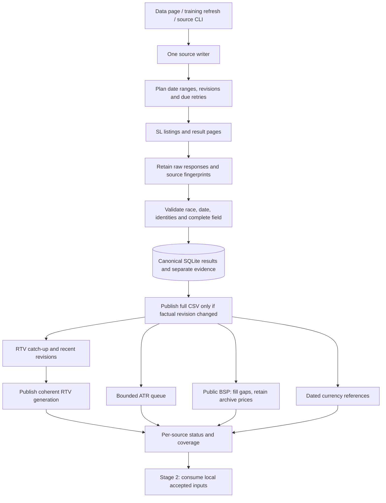

# Stage 1 collection improvements — 4 November 2026

This implements the first consolidation pass from the
[stage 1 audit](STAGE1_DATA_PIPELINE_AUDIT_2026-11-04.md). The existing local
SQLite/Parquet storage and numerical feature definitions remain the foundation.

The [live recovery follow-up](STAGE1_RECOVERY_2026-11-04.md) records the subsequent
installed catch-up, BSP repair, cached-refresh timings and horse-identity finding.

## Normal operation

The installed process now follows this source plan:



Independent sources overlap after canonical SL collection, within their existing
provider rate limits. Refreshes and historical recovery share validation and
publication. Unfinished work stays queued; an overall `partial` result blocks
an automatic training refresh rather than masquerading as full coverage.

RTV's current materialisation still includes fitted time-par and quarterly text
views. Moving those into the feature-build stage remains a separate boundary
cleanup. Genuine pre-race observations still require prospective capture.

The [5 November identity follow-up](STAGE1_IDENTITY_2026-11-05.md) records the
installed source-ID migration and next-day coverage.

```powershell
.venv\Scripts\python.exe -m src.source_pipeline --sync 14 --results-only
```

The command reports each source separately: `sl`, `rtv`, `atr`, `bsp` and `fx`.
Its overall state is `ok`, `partial` or `busy`; partial/busy refreshes exit
nonzero. The requested run is saved in `data/source_refresh/last_run.json`,
while `status.json` retains combined coverage and per-source check times. See
the [5 November follow-up](STAGE1_SOURCE_HEALTH_2026-11-05.md). The run is displayed
by the Data page. Ordinary training checks this report rather than silently
continuing after a failed catch-up. `--no-refresh` remains the explicit way to
train from local history.

ATR collection has a default budget of 50 races per invocation. Its
recovery cursor retains the beginning of an older gap even when newer races
are collected first. Rerunning the command continues that queue. A deliberate
larger budget can be supplied with `--atr-max-races 200`. Irish/other venues
already classified as outside ATR coverage are excluded from that queue.

BSP collection fills missing prices from the existing public daily-file parser.
It preserves known archive prices and timed trades; public average prices are
not substituted for a timed trade. Ambiguous joins fail before publication.
Coverage reports include complete fields, fallback fields and preserved price
conflicts. The existing complete-field SP fallback remains supported.

## What changed

### One source plan and visible outcomes

`src.source_pipeline.refresh_sources` is the small-report API for the CLI,
maintenance app and training refresh. The previous DataFrame API remains a
compatibility wrapper, with the report attached in `frame.attrs['source_refresh']`.

`data_collector`, the results scraper's saving route, and the database CLI now
use the shared coordinator. A caller cannot select synthetic data through an
unrecognised source name. Explicit samples are written to
`sample_race_results.csv`, separate from the real-data handoff.

Current pending result jobs and unverified recent listings also appear in
`project_status.py`. A fresh maximum result date no longer certifies an
otherwise incomplete recent collection.

### Revision-aware canonical publication

The database records factual inserts, updates and deletions using SQL triggers.
This includes direct edits by older repair tools. Scrape timestamp changes do
not count as factual changes. Each accepted CSV export has a database identity,
content revision and file receipt.

An unchanged report refresh reads no full result DataFrame and writes no full
CSV. A missing, replaced or outdated export is republished atomically, retaining
the established CSV type/NA contract. The low-level compatibility reader still
loads history when its caller explicitly requests a DataFrame.

One operation lock prevents competing normal result refreshes from duplicating
requests and publishing snapshots out of order. If an external writer advances
the database during publication, the resulting report is partial rather than
claiming that the export contains that later revision.

Recent completed Sporting Life fields become eligible for another result-page
check after six hours within the seven-day revision window. Explicit rechecking
can cover an older range. A proposal that conflicts with an independently
reviewed result is left pending for review while the accepted field survives.

### Recoverable historical ranges

The same coordinator accepts explicit inclusive dates:

```powershell
.venv\Scripts\python.exe -m src.source_pipeline --start 2026-10-01 --end 2026-10-31
```

RTV recovery is no longer capped at ten days. Ten days remains its recent
revision window. Existing stable historical base partitions are reused where
available; missing dates and incomplete observations are recovered.

The explicit RTV builder writes standard quarter partitions. Readers also
understand earlier explicit-range filenames and select the newest replacement
for overlapping races. A range build replaces complete affected quarters from
the raw store, preserving the rest of each quarter. It no longer removes all
previous partitions before starting.

### Coherent RTV publication

Recent parsed tables and the four history materialisations (runs, cards, text
and scores) are prepared before one generation pointer is switched:
`data/rtv_cache/pipeline/generation.json`.

Failed or partial refreshes retain the previous accepted view. A partial daily
manifest does not hide complete historical base rows. Feature readers pin one
history generation while resolving its related files. Standalone materialisation
uses the same writer lock, and explicit research destinations remain separate.

The core RTV collection profile omits the research tips, tipsters and odds
endpoints. A core-complete date does not masquerade as a research-complete
date. The shared request-rate limits remain unchanged. Recent result/card
responses, including a previous 404, are eligible for bounded revision checks.

The fixed winning-time par is cached by its fitting-code and actual input
content, so an unchanged source refresh does not fit its 400 trees again.

### Retained evidence and offline replay

Normal Sporting Life result collection retains distinct response bodies in
`data/sl_cache/raw.sqlite`, with hashes and first/last observation times. Repeated
identical responses reuse the body. Newly parsed winning time, actual off time
and explicit prize currency are also retained in `result_race_observations`;
they are not silently added as model columns.

Previously captured source responses can be reparsed without HTTP:

```powershell
.venv\Scripts\python.exe -m src.source_pipeline --start 2026-10-01 --end 2026-10-31 --sources sl --replay
.venv\Scripts\python.exe -m src.source_pipeline --start 2026-10-01 --end 2026-10-31 --sources rtv --replay
```

SL responses fetched before retention was introduced may be unavailable; those
jobs report an error rather than falling back to HTTP during an offline replay.
Accepted result corrections remain protected during replay.

### Budgeted enrichment and source fetching

`--enrich` drains up to 100 due pedigree profiles independently of whether new
result rows were inserted. Failed profiles retain an attempt count and a retry
time instead of becoming permanent empty successes. Previously parked failures
can become eligible again. Successful empty profiles remain distinct from
failed fetches. Historical successful-empty rows whose original status cannot
be distinguished are not reclassified as successful merely to drain the queue.

Weather is an explicit `--weather` research job. Currency-rate fetching is
performed by the `fx` source operation; ordinary currency conversion reads dated
references without a network request. Racecards have a 15-minute automatic
cache age and atomic cache writes. Lookahead card loading goes through the
same wrapper that captures today's RTV observations.

Targeted missing-race, draw and wind-surgery maintenance tools now publish their
canonical changes through the shared writer/publisher. Custom staged databases
are not exported over the installed canonical CSV.

## Verification

Evidence is under
`data/audit/stage1_implementation_20261104/`:

- `checks/`: source tests, regression checks, the full-suite run and lint output.
- `nochange_verification.json`: installed-data timings and SHA-256 checks of the
  CSV before and after publication; the verifier rejects all HTTP requests.
- `before/`: copies of the existing working-tree files preserved before the
  implementation began.

The regression checks cover due revisions, protected corrections, direct SQL
repairs, unchanged exports, concurrent publishers, raw replay, enrichment retry,
synthetic isolation, long RTV gaps, overlapping historical partitions, pinned
generations, interrupted materialisation, par caching, pure currency processing,
and BSP merge integrity.

Final verification results:

- **352 focused source, parsing, feature-input and readiness tests passed** in
  `checks/final_source.txt` (14 existing pandas/third-party warnings).
- **39 final recovery/publication tests passed** after adding empty-calendar
  handling, followed by **four targeted final checks** for that handling,
  read-only sample budgets and source-signature coverage.
- The full suite recorded **1,511 passed / three failed**. Its missing source
  classification was fixed and passes in the focused run. The other two
  failures reproduce using the saved pre-change collection code:
  `test_append_matches_full_rebuild` (four rank-tie differences in an unselected
  feature) and the old ATR benchmark's exact feature-registration check. See
  `checks/baseline.txt` and `checks/baseline_atr.txt`; the latter is a benchmark
  registration failure, not evidence that its invariance check found leakage.
- Source lint and the whitespace/diff checks pass. The original working tree
  already contained substantial changes; those were preserved.

Installed-data publication check: the first receipt-based publication took
58.2344 seconds; the next unchanged report refresh took **0.8518 seconds**.
The 211,342,560-byte CSV retained the identical SHA-256
`42e05cec8391bf5df6a6cd3600152f54b1ecb305699e438b16699b571681beb2`.
Both checks rejected HTTP and preserved 755,309 runners / 80,302 races through
29 October. This measures local publication work, not a complete source scrape
or feature build. The verification runs alongside the test suite and is a
diagnostic sample rather than a repeated isolated benchmark.

## Remaining work and boundaries

These source changes do not establish new predictive scores. Reader-source
signatures change, so a compatible feature-store rebuild and subsequent model
qualification belong to stages 2 and 3.

The initial installed readiness probe reported four recent pending result jobs
and could not read the protected feature-store `meta.json`. The live recovery
follow-up obtained read access, cleared the recent jobs and verified the newer
store. ATR remains incomplete and the promoted model has an older feature
generation; see that report for current counts and readiness evidence.

Large ATR and unresolved historical-result backlogs remain data-recovery jobs;
they are exposed and resumable rather than silently assumed complete. The old
pending-job count includes abandoned/unavailable races and needs source-backed
classification, not blanket insertion or deletion.

The derived RTV history files are still consolidated Parquets inside each
accepted generation. Date-partitioning those derived files and establishing a
retention policy for unreferenced generations are follow-up storage optimisations.
Quarterly text models also retain their existing fitting recipe and explicit
refit workflow; dependency-based invalidation of those fitted models is a
separate derived-feature change. This pass caches the fixed time par and makes
publication safe without changing those fitted numerical definitions.
